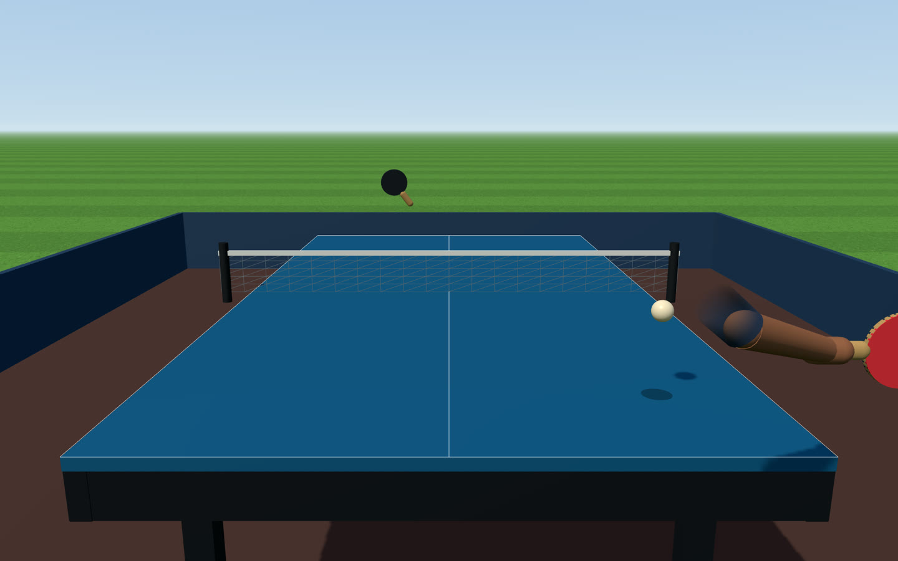
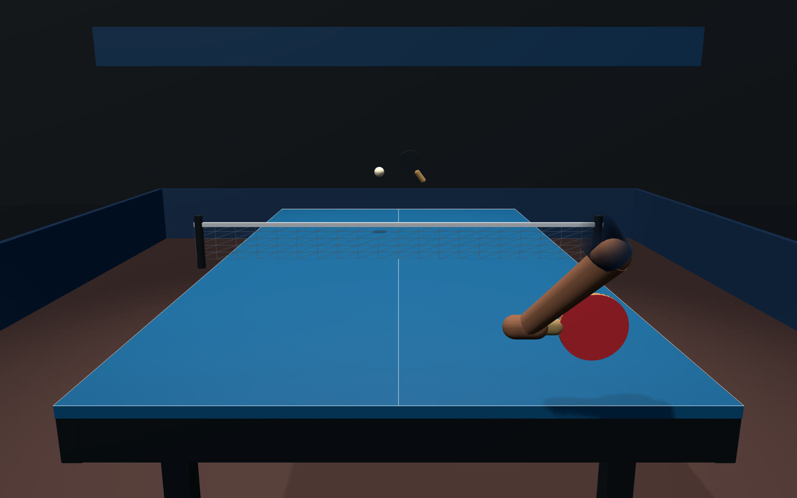

# Virtual Table Tennis

> **An experiment, built out of curiosity.** This is the first prototype — can a plain laptop webcam replace a controller for a fast sport? It works and it's fun, but expect rough edges.

Play table tennis against a CPU opponent with your **real arm** — no controller, no sensors, just a laptop webcam. Your swing drives a 3D paddle, the ball follows real physics, and the first to 11 wins.



Everything runs locally in your browser. Webcam frames are processed on your device and are never recorded or uploaded.

**If you like it, please ⭐ star the repo** — it helps other builders find it.

## Quick start

Requires **Node.js 20+** and a recent **Chrome** or **Edge** (Safari and Firefox work, Chrome is fastest).

```bash
git clone https://github.com/Codehack-01/Virtual-tabletennis.git
cd Virtual-tabletennis
npm install        # also downloads the pose models into public/
npm run dev        # open http://localhost:5173
```

Use `localhost`, not a network IP: browsers only allow camera access on secure origins.

## How to play

1. Click **Enable camera** and allow access.
2. Stand 1–2 m from the laptop so your **head, shoulders and paddle arm** are in view.
3. Hold your ready stance for a moment — the game captures it as your neutral position automatically. Use **Calibrate** in the control bar any time to redo it.
4. Press **Start match**. The CPU serves; swing to return the ball. Points are scored automatically for misses, net faults, balls sent long and double bounces.

### Get the best tracking

- **Play in a bright room, lit from the front.** Daylight or a lamp facing you works best. A dark room or a window behind you makes the camera use longer exposures, which blurs fast swings and makes the paddle jitter or lag.
- Keep your whole paddle arm in the picture, including when you swing out wide.
- One person in view — if several people are visible, the tracker picks one.
- Plug the laptop in. The game uses the more accurate *full* pose model and drops to the *lite* model automatically on slower machines.

### Controls

The control bar at the bottom: feed a single ball · start/restart a match · reset the ball · switch between the **outdoor** and **indoor** court · show/hide the tracking lines on your camera view · calibrate · settings and diagnostics.



## How it works

```
Webcam ─▶ Tracking ─▶ Motion ─▶ Paddle controller ─▶ Physics & rally ─▶ 3D render
          src/tracking src/motion src/control         src/physics, src/game  src/render
                  └──────────── orchestrated by src/engine (outside React) ────────────┘
```

| Layer | Files | What it does |
|---|---|---|
| Tracking | `tracking/` | Webcam + MediaPipe Pose Landmarker. Turns each frame into wrist, elbow, shoulder and hip landmarks. |
| Motion | `motion/` | One Euro filtering (steady at rest, fast in a swing), glitch and one-frame-spike rejection, velocity, and the swing detector. |
| Control | `control/` | Calibration and mapping of your hand into the paddle area, render-rate smoothing between camera frames, forehand/backhand blade side, and the rendered arm (two-bone IK). |
| Physics | `physics/` | Fixed 240 Hz ball simulation with gravity, drag, table/net/paddle collisions and a swept paddle test, so a fast ball can't pass through the paddle between frames. |
| Game | `game/` | Serve, rally and scoring rules, plus a CPU opponent that returns reliably but makes human mistakes. |
| Render | `render/`, `audio/` | three.js court with outdoor and indoor scenes, the player arm and paddles; impact sounds. |
| UI | `App.tsx`, `ui/` | React overlay: scoreboard, camera card, control bar, settings drawer, game-over screen. |

## Scripts

| Command | What it does |
|---|---|
| `npm run dev` | Start the dev server |
| `npm test` | Run the unit tests (filters, swing detection, physics, rally rules, arm stability) |
| `npm run build` | Typecheck and build for production into `dist/` |
| `npm run setup:assets` | Re-download the pose models and MediaPipe runtime |

## Tuning

Settings are in the drawer (sliders icon) and are saved in your browser.

| Symptom | Try |
|---|---|
| Paddle shakes while you hold still | More light on you first; then lower *Smoothing at rest* |
| Paddle lags behind fast swings | Raise *Speed responsiveness* |
| You have to reach too far | Recalibrate with a smaller sweep, or raise *Gain* |
| Tracking drops out | Better lighting and framing; then lower *Min wrist visibility* |
| CPU too easy or too hard | Adjust *Opponent mistakes* (and *Opponent shot speed*) |

## Limitations

- A webcam sees your arm in 2D. The paddle follows your hand's position and swing speed; it can't see your wrist angle or the real paddle face, so spin isn't modelled.
- Laptop webcams run at about 30 fps, which adds some delay. Expect roughly 70–120 ms from movement to screen.

## Credits

Built by [Bildyard](https://bildyard.com). If you share or build on this project, please credit **@adexbuilds** or **@bildyard** on Instagram or X. And if it helped you, a ⭐ on the repo is the best way to say thanks.

- Pose tracking: [MediaPipe](https://developers.google.com/mediapipe) (Apache 2.0)
- 3D: [three.js](https://threejs.org) (MIT) · UI: [React](https://react.dev) (MIT)
- Impact sounds: [Aj_ on OpenGameArt](https://opengameart.org/content/ping-pong-sounds) (CC0)

## License

[MIT](LICENSE) — free to use, modify and share.
